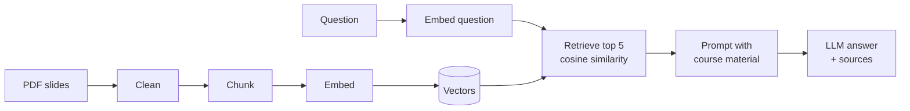

# Lumi

**Study any course with AI, without going off-topic.**

Lumi is a study assistant built with **RAG** (Retrieval-Augmented Generation). Give it a folder of PDF slides and ask questions in Italian, Spanish or English: it answers **only** with what the course says, shows the slide the answer comes from and lists the pages at the end, so you can always check.

> In Italian, *chiedere lumi* means "to ask for clarification". With Lumi, you ask your own slides.

---

## See it in action

### 1. Ask the whole course
A question is searched across every lecture. The answer is short and easy to read, with the sources at the very end.


### 2. Focus on one lecture
Pick a lecture in the sidebar and the search stays inside it (metadata filter).


### 3. See the slide behind the answer
Under every answer Lumi renders the original page of the PDF that matched best, so charts and tables are visible too.


### 4. Diagrams redrawn, not pasted
When the best slide is a diagram, Lumi shows a clean redrawn version instead of a photo of the page.


### 5. Honest when the course is silent
Ask something the course does not cover and Lumi says so, instead of inventing an answer.


### 6. It explains itself
The **How it works** mode is a live walkthrough of the pipeline, built from the real data: cleaning, chunking, an embedding map, a search you can try, and the actual prompt.


---

## Any subject, same code

Lumi is not tied to one course. Put the PDFs of any subject in `data/rag_papers/`, restart, and it reads, cleans, splits and indexes them on its own. Lecture names come from the file names (`04_seaborn.pdf` becomes "04 Seaborn").

It was tested on two different courses (one in English, one in Italian) without changing the code.

---

## How it works



| Step | What happens | Why |
|---|---|---|
| **Read** | `pypdf` extracts the text page by page | Each piece of text keeps its document and page |
| **Clean** | Lines repeated on at least 50% of a document's pages (copyright, page numbers) are removed automatically | Repeated noise makes every chunk look alike |
| **Chunk** | 1000 characters with 200 of overlap; exact duplicates removed; animation builds merged into their complete version | Small, precise pieces; no idea cut in half; no duplicates wasting the top 5 |
| **Embed** | `nomic-embed-text` running locally with Ollama, cached to disk | Free, no daily quota, the materials never leave the laptop |
| **Retrieve** | Cosine similarity, top 5 chunks, optional lecture filter | The 5 most relevant pieces become the context |
| **Generate** | Gemini answers using only the retrieved material | Grounded answers, sources listed at the end |

### Engineering details

- **Model fallback chain**: `gemini-3.8-flash` → `gemini-3.6-flash` → `gemini-3.5-flash-lite` → `gemini-3.1-flash-lite` → `gemma-4-31b-it` → local `qwen3.5:0.8b` with Ollama. A 503 (high demand) waits and retries; a 429 (quota reached) moves to the next model. The demo never gets stuck.
- **No hallucinated answers**: when the material does not contain the answer, the model returns a fixed code (`NOT_FOUND_IT`, `NOT_FOUND_ES`, `NOT_FOUND_EN`) and the app shows a fixed message in the language of the question.
- **Readable answers**: direct opening sentence, key terms in bold, short lists, no citations in the text; the references are split from the answer and shown at the end.
- **Feedback**: thumbs up / down on every answer are saved to `data/feedback.jsonl` with the question and the retrieved pages, ready for future evaluation.
- **Embedding cache**: invalidated automatically when the chunks change.

---

## Evaluation

15 questions with known answer pages, measured on the first course (`stage3_evaluation.ipynb`):

| | Hit@1 | Hit@5 | Chunks |
|---|---|---|---|
| Baseline (no cleaning, no dedupe, no merge) | 40% | 73% | ~390 |
| **Lumi** | **47%** | **67%** | **257** |

Hit@k = the right page is among the first k retrieved chunks. With 15 questions one question is worth 6.7 points, so the differences are not significant; the clear gain is **a third fewer chunks** with the same retrieval quality. Questions in Spanish are the hardest, because the local embedding model is mostly trained on English.

---

## Project structure

```
app.py                     Streamlit app: chat, lecture filter, slides, feedback
walkthrough.py             "How it works" mode
rag_core.py                The RAG pipeline: read, clean, chunk, embed, search, prompt, fallback
diagrams.py                Hand-redrawn SVG diagrams
stage1_minimal_rag.ipynb   Step by step on one lecture
stage2_full_course.ipynb   The whole course, multi-page chunks, lecture filter
stage3_evaluation.ipynb    Baseline vs Lumi, Hit@1 and Hit@5
eval_questions.json        The 15 evaluation questions
```

---

## Run it

Requirements: [uv](https://docs.astral.sh/uv/), [Ollama](https://ollama.com/) and a Gemini API key.

```bash
uv sync
ollama pull nomic-embed-text
ollama pull qwen3.5:0.8b          # optional, last-resort local model
cp .env.example .env              # then add your GEMINI_API_KEY
# put your PDFs in data/rag_papers/
uv run streamlit run app.py
```

The first start computes the embeddings (a minute or two); after that they are loaded from the cache.

## Privacy

Course materials and their embeddings live in `data/`, which is **not** pushed to GitHub. Only the question and the 5 retrieved chunks are sent to the LLM.

## Roadmap

- **Memory**: follow-up questions that remember the conversation
- **Query rewriting**: the LLM rewrites vague questions before searching
- **Multilingual embeddings**: better retrieval for Spanish and Italian questions
- **Automatic diagram redrawing** for every schema in the slides
- **Vector database** (e.g. Weaviate) for thousands of documents

---

Final project for **Machine Learning Advanced**, ITS Angelo Rizzoli, Milan.
Angel Bohorquez
